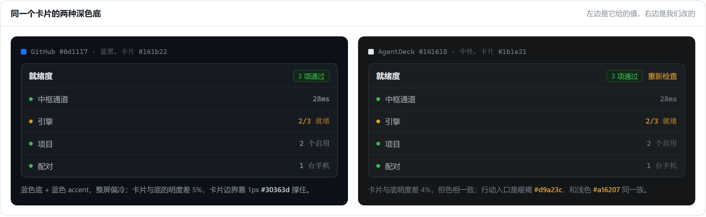

# AgentDeck 界面规范 v3

> 口径来源：`design/v3-windows.html`、`design/v3-phone.html`。写 WinForms / Compose 时以本文为准，样稿只作效果对照。
> 一句话：中性底、白卡、一像素边、不用阴影；颜色只用来表达「状态」和「可点」，其余一律灰阶。

---

## 1 两端必须一致的部分

这十三个值**不许**按平台改动，改了两端就会像两个产品。深色主题的对应值见 §10，但「谁与谁同值」的关系在深浅两套里完全一致（`link` 永远等于 `warn`，`act` 永远等于 `t1`）。

| Token | 值 | 用途 |
|---|---|---|
| `act` | `#1b1f24` | 主行动：主按钮底、发送键、选中态、强调文字 |
| `act-hover` | `#2b3138` | 主按钮悬停 / 按下 |
| `link` | `#a16207` | 所有文字行动入口（查看轨迹、重新检查、日志） |
| `ok` | `#15803d` | 就绪、运行中、已批准 |
| `ok-bg` | `#ecf7ef` | `ok` 的标签底 |
| `ok-line` | `#cfe8d8` | `ok` 的标签边 |
| `warn` | `#a16207` | 待处理、部分就绪、需要人看一眼 |
| `warn-bg` | `#fdf7e6` | 同上底 |
| `warn-line` | `#f0e2bd` | 同上边 |
| `danger` | `#b42318` | 待审批、失败、叫停、拒绝 |
| `danger-bg` | `#fdeceb` | 同上底 |
| `danger-line` | `#f6d3d0` | 同上边 |
| `mono` | `ui-monospace, "Cascadia Mono", "Consolas", "SF Mono", monospace` | 路径、命令、端口、版本号、时间 |

`link` 与 `warn` 同值不是笔误：在 AgentDeck 里，需要人处理的事和能点开的入口本来就是同一类注意力，共用一个暖褐。**行动入口永远不用蓝色**。

---

## 2 允许分叉的部分：中性色

只有一层允许不同，理由也只有一个——屏幕距离。

| Token | Windows | 手机 | 说明 |
|---|---|---|---|
| `bg` | `#f5f6f7` | `#f7f4ef` | 桌面偏冷（长时间盯），手机偏暖（手持、室内） |
| `card` | `#ffffff` | `#ffffff` | 一致 |
| `line` | `#e3e6ea` | `#e9e3da` | 卡片与控件边框 |
| `line-soft` | `#eef0f2` | `#f1ece5` | 卡内分隔线、表格行线 |
| `t1` | `#1b1f24` | `#1b1f24` | 正文（与 `act` 同值，故意） |
| `t2` | `#5a616b` | `#5f6058` | 次级文字、未选中 |
| `t3` | `#8b929c` | `#9c9a92` | 注释、时间戳、占位符 |
| `bg-alt` | `#fafbfc` | `#f6f3ee` | 表头、侧栏、代码块底。浅色下比 `bg` **亮**，深色下比 `bg` **暗**——它是「与主区不同层」而不是固定的「下沉」 |

**判断标准**：如果某个新色值要在两端出现，先问它是不是状态色——是状态色就必须同一个值；不是，就归到这张表里，各平台各自微调。

---

## 3 字号阶梯

| 角色 | Windows | 手机 | 备注 |
|---|---|---|---|
| 窗口/页面标题 | 15 · 600 | 19 · 600 | 手机比桌面大两号，因为握距远 |
| 卡片标题 | 13 · 600 | 15.5 · 600 | |
| 正文 | 13 · 400 | 13.5 · 400 | 手机正文不小于 13.5 |
| 表单项 / 输入 | 12.5 | 14 | 手机输入框 ≥ 14，否则 iOS 会放大页面 |
| 表头 / 分组标题 | 11 · 400 · `t3` | 12 · 400 · `t3` | 不加粗、不加色块 |
| 标签、时间戳、注释 | 11–11.5 | 11–11.5 | **全产品最小 11，不许再小** |
| 数字与路径 | mono 同号 | mono 同号 | 混排时 mono 比正文小 0.5–1px |

字重只用 400 / 500 / 600 三档。600 仅用于标题和选中项，**不许用 700**（在 Windows 上会糊）。

---

## 4 圆角、间距、密度

| Token | Windows | 手机 |
|---|---|---|
| 卡片圆角 | 10 | 16 |
| 按钮圆角 | 6 | 13（大）/ 10（小） |
| 标签圆角 | 5 | 6–7 |
| 输入框圆角 | 6 | 12–16 |
| 卡片内边距 | 14（横）/ 11（头） | 14 |
| 卡片间距 | 12 | 10 |
| 行内垂直间距 | 10–11 | 10–11 |
| 控件高度 | 按钮 28、小按钮 24、行 33 | 主按钮 48、次按钮 36、触控目标 ≥ 44 |

密度靠**间距**做，不靠分隔线。同一张卡里最多出现一条 `line-soft`。

圆角必须**从大到小**嵌套：卡片 16 → 内部块 12 → 按钮/标签 7 以内。不允许卡内出现比卡片更大的圆角。

---

## 5 组件规格

**卡片**：白底 + 1px `line` + 圆角，**无阴影**。阴影只用于两种浮起：手机底部输入条（`0 2px 8px rgba(40,35,28,.04)`）、手机机身示意（样稿专用，产品里不要）。

**卡头**：左标题（600）+ 可选标签 + 右侧行动区（`margin-left:auto`，间距 10）。行动区里的按钮按「主 → 次 → 文本链接」自左向右降级，最右一个永远是危险或关闭类操作。

**表格（仅 Windows）**：表头 `bg-alt` 11px `t3`，行 12.5px，行线 `line-soft`，无竖线、无斑马纹。数值列右对齐，路径列等宽。

**键值行（仅手机）**：`k` 固定 84px 宽、12.5px `t3`；`v` 占满剩余。行间 `line-soft`，最后一行无边框。

**标签**：高 20（PC）/ 20（手机），左右内边距 6–8，字号 11，字重 500，1px 同色系边框、浅色底。标签只表达类别和状态，**不做按钮**；能点的东西一律用 `pill` 或 `link`。

**按钮层级**：一屏只允许一个主按钮（`act` 底白字）；其余为白底细边；危险操作用 `danger` 文字 + `danger-line` 边，**不用红底**（红底会被当成主按钮）。

**左状态条**：只在列表卡上使用，宽 3px、上下内缩 12px、圆角 2。purpose 是让人扫读列表而不读标签：红=待批、绿=运行中、灰=离线或失效。**详情页不用状态条**，改用标签。

**就绪度**：Windows 用四行（名称 + 值 + 右侧「重新检查」）；手机用四格条（4px 高、间隔 6）呈现概览，点开进详情再看四行。两种呈现必须共用同一个状态源。

**输入条（手机）**：固定在 tab 之上，白底圆角 16、内边距 8，右侧 34px 圆形发送键（`act` 底）。下方一行 11px `t3` 提示（如「提交后带 requestId，断线重试不会重复执行」），这行字不是装饰，是承诺。

---

## 6 状态语义表

| 状态 | 色 | 文字 | 出现位置 |
|---|---|---|---|
| 已连接 / 就绪 / 运行中 | `ok` | 已连接、就绪、运行中 | 状态点、标签、就绪度条 |
| 部分就绪 / 待处理 | `warn` | 2/3 就绪、剩余 2:41 | 状态点、就绪度条、倒计时 |
| 待审批 | `danger` | 待批准、命令 | 状态条、标签、badge |
| 失败 / 已拒绝 | `danger` | 已拒绝、失败 | 标签、事件点 |
| 离线 / 失效 | `t3` + `#c9c4ba` | 离线、未登录、已过期 | 状态点、灰标签 |
| 中性事件（消息） | `#9aa0a6` | — | 轨迹事件点 |

**颜色不能单独承载信息**：每个着色元素旁边必须有文字。色盲用户看到的是「待批准」三个字，不是红色。深色下色相不变、只提亮，所以这张表在深浅两套里通用。

---

## 7 六条禁令

1. 不用蓝色做行动色或链接色。
2. 不用阴影表达层级，用边框和留白。
3. 不用彩色底做分组标题，分组标题只有灰字。
4. 不把标签做成按钮，也不把按钮做成标签。
5. 不在正文里用 700 字重，不用小于 11px 的字。
6. 一屏不给两个主按钮。

---

## 8 落码映射

**WinForms**（`AgentDeck.Tray` / 设置窗口）
- 字体：`Segoe UI` 12.5px ≈ `9pt`；标题 600 用 `new Font("Segoe UI", 9f, FontStyle.Bold)`（WinForms 无 600，用 Bold 近似，且只用于标题）。
- 等宽：`Cascadia Mono`，未装则回落 `Consolas`。
- 圆角：WinForms 原生不裁圆角，两个选择——卡片用 `Panel` + `Paint` 自绘 `GraphicsPath`（推荐，代价小），或整体改方角（2px）以免半圆不圆。**不要**用 `Region` 裁圆角，边缘会有锯齿。
- DPI：`AutoScaleMode = Dpi`，所有尺寸写 `LogicalToDeviceUnits`，圆角半径也要换算。
- 颜色：把 §1 抄成 `static class Tokens`，禁止在控件里写十六进制字面量。

**Compose**（`AgentDeck` 手机端）
- `lightColorScheme(primary = Act, onPrimary = White, surface = Card, background = Bg, error = Danger)`；`link`/`warn` 走自定义 `LocalAgentColors`，不要塞进 `secondary`（会被 Material 组件擅自使用）。
- `Shapes(medium = RoundedCornerShape(16.dp), small = RoundedCornerShape(10.dp))`。
- 触控目标统一 `Modifier.heightIn(min = 44.dp)`。
- 状态条用 `Row` 首列 3.dp 的 `Box` + `clip(RoundedCornerShape(2.dp))`，不要用 `Card` 的 `border` 模拟。
- 字号走 `Typography` 覆盖，禁用 Material 默认的 14/16/22 阶梯。

---

## 9 与功能清单的对应

| 清单条目 | 用到的规范 |
|---|---|
| #1 就绪度 | §6 状态表 + §5「就绪度」两种呈现 |
| #5 执行轨迹 | §6 事件点着色（消息灰、命令红、文件琥珀、结束绿） |
| #6 预览端口 | §5 卡片 + `link` 行动；预览块本身用中性底，绿只留在图标 |
| #8 白名单与执行权限 | §5 单选卡 + 表格；策略生效范围用标签而非颜色区分 |
| #9 常驻与自启 | §5 键值行 + `ok/off` 双态 |

---

## 10 深色主题

**样张**：真实组件以 `v3-wd-*.png`、`v3-pd-*.png`（两份设计稿的深色截图）为准，底色的并排对比见**附录 A**。取值参考过一份 Codex 主题配置（`surface:#0d1117`、`ink:#e6edf3`、`accent:#1f6feb`、`contrast:60`、`opaqueWindows:true`），采纳与拒绝的理由见 §10.3。

### 10.1 深色 token

| Token | 浅色 | 深色 | 说明 |
|---|---|---|---|
| `bg` | `#f5f6f7` | `#141618` | 不用 `#0d1117`：它是蓝黑（B 分量最高），与中性浅色断裂 |
| `card` | `#ffffff` | `#1b1e21` | 比底亮 4% |
| `bg-alt` | `#fafbfc` | `#101214` | 深色下压暗，与浅色的「提亮」等价 |
| `line` | `#e3e6ea` | `#2b3035` | |
| `line-soft` | `#eef0f2` | `#23272b` | |
| `t1` | `#1b1f24` | `#e4e7ea` | 不用 `#e6edf3`：那组偏蓝 13 个 B 分量 |
| `t2` | `#5a616b` | `#a3a9b0` | |
| `t3` | `#8b929c` | `#737a82` | |
| `act` / `on-act` | `#1b1f24` / `#fff` | `#e6e9ec` / `#141618` | **方向翻转**，见 10.2 |
| `act-hover` | `#2b3138` | `#f4f6f8` | |
| `link` = `warn` | `#a16207` | `#d9a23c` | 两者始终同值，这条不变 |
| `ok` | `#15803d` | `#3fb950` | 同色相 140°，提亮 18% |
| `ok-bg` / `ok-line` | `#ecf7ef` / `#cfe8d8` | `#13261a` / `#1f4a2c` | |
| `warn-bg` / `warn-line` | `#fdf7e6` / `#f0e2bd` | `#2a2113` / `#453520` | |
| `danger` | `#b42318` | `#f85149` | 同色相 2° |
| `danger-bg` / `danger-line` | `#fdeceb` / `#f6d3d0` | `#2a1614` / `#52241f` | |

手机端深色比 PC 各暖 2 个点（`bg #161513` / `card #1e1c19` / `t1 #e8e5df`）。**但这个差异已经小到不指认不出**，是预期结果：暗色低明度会放大色相偏差，暖调一旦明显就显得脏。

### 10.2 主按钮在深色下必须反相

浅色：主按钮是最暗的一块（`#1b1f24` 底 + 白字）。
深色：主按钮是最亮的一块（`#e6e9ec` 底 + `#141618` 字）。

规则没变——**对比度最高的一块 = 主行动**，只是方向翻转。深色下若继续用近黑按钮，它会直接消失在底色里。手机发送键同理：浅色近黑圆钮，深色近白圆钮 + 深箭头，位置与尺寸不变。

### 10.3 从 Codex 主题配置里采纳了什么

| 字段 | 处理 | 理由 |
|---|---|---|
| `surface` 三层思路 | 采纳结构，重取值 | 层级要留，色相不能跟着变 |
| `opaqueWindows:true` | 采纳 | 这个窗口用来读状态做决策，透出底下的代码会干扰判断；WinForms 做 Mica 也要额外代价 |
| `contrast:60` | 采纳思路，不用数值 | 我们只有四层、每层差 3–5% 明度；层数少时对比过强会显脏 |
| `semanticColors` 只有两项 | 采纳这个克制 | 语义色白名单保持三条：ok / warn / danger，不加第四个 |
| `diffAdded #3fb950` | 采纳为深色 `ok` | 暗底上青分量低，比自调的绿更稳 |
| `diffRemoved #f85149` | 采纳为深色 `danger`，但**不用它给行文字上色** | 轨迹里只有 `−18` 这种计数，没有整行 diff。整行染红会盖过真正的状态色，红只留给「待批准 / 已失败」 |
| `accent #1f6feb` | **拒绝** | 蓝色撞「行动色禁用蓝」 |
| `ink #e6edf3` | **拒绝** | 偏蓝。深色正文改 `#e4e7ea`，否则像 GitHub 不像 AgentDeck |
| `skill #ad7bf9` | **拒绝** | 我们没有 skills 概念；第四个语义色会让「颜色=状态」失效 |
| `fonts.ui: Inter` | **拒绝** | Windows 上 9–13px 小字号 Segoe UI 的字宽与 ClearType 调校更好；Android 上 Inter 也不是系统字体 |
| `codeThemeId: github` | 暂不需要 | 轨迹不做语法高亮，只有路径、命令、行数计数 |

### 10.4 样稿与三处实现陷阱

两份样稿已支持切换：`?theme=dark` 强制深色、`?theme=light` 强制浅色、不带参数则跟随系统并记住上次选择（`localStorage` 的 `ad-theme`）。Windows 稿右上角、手机稿右上角各有一个评审用的开关，**产品里不出现这个开关**。

写代码时会再遇到的三件事：

- **主行动色必须是独立 token（`act` / `on-act`）**。样稿里凡是 `color:#fff` 的图标或文字，深色下都要吃 `on-act`；否则发送键会变成「近白圆 + 白箭头」，直接消失。
- **内嵌代码块在深色下要更暗，不是更亮**（`code-bg: #101210`）。浅色里代码块比底略暗，深色里也只有继续暗才符合「凹陷」的直觉；按「深色下所有层都往上提亮」的惯性处理，代码块会浮起来。
- **时间线竖线要单独取值**。它和卡片框线共用一个 `line` 时，深色下几乎不可见；需要单独提到 `#443e36`。同理，数字角标在深色下是红底 + 深字（`on-red`），不是红底白字——`#f85149` 上的白字只有 3:1。

### 10.5 切换规则

- **跟随系统**，不提供手动开关（清单里「深浅主题切换」本来就砍掉了）。Windows 用 `UISettings.ColorValuesChanged`，Compose 用 `isSystemInDarkTheme()`。
- 立即生效，只重绘不重建窗口：换掉 `Tokens` 的静态引用后 `Invalidate()`。
- **不做**：渐变过渡、亚克力/毛玻璃、深色下换一套圆角。圆角与尺寸一律不随主题变。
- 深色下唯一仍是浅底的元素是**二维码**，它必须保持高对比才能被扫。

## 11 明确不做

- **Windows 高对比度模式**：不单独适配，不提供开关。系统开启高对比度时按系统色走，样式表不介入，也不为此退化成方角。
- **手机横屏**：只覆盖竖屏 393×852，横屏不排布、不适配。
- 手动主题切换开关、定时切换、「跟随日出日落」。

## 附录 A · 深色底色的并排对比

左边是 §10.3 里那组被拒的 Codex 原值（`#0d1117` 底 + `#161b22` 卡 + `#1f6feb` 强调），右边是实际采用的 `#141618` / `#1b1e21` / `#d9a23c`。两张卡片的结构、字号、行高完全相同，只换了颜色。

**这一条为什么留图、不留色值表**：`#0d1117` 与 `#141618` 在十六进制里看着像同一个颜色（三个分量相差都不超过 23），但并排放在一起、周围又只有中性元素时，左边的**蓝**是能直接看出来的——它是 B 分量最高的蓝黑。这种判断无法用一行色值传递。所以规范里不给「深色底候选值」的清单，只给这一张图和一句结论。

**从这张图能读出的三条**：

1. 深色底选中性灰，不选蓝黑。一旦底色偏蓝，界面就会像 GitHub，不像 AgentDeck；而且浅色侧是中性灰，深浅切换时会有一次色相跳变。
2. 卡片与底的明度差只要 4–5%，**边界靠 1px 边框撑住**，不靠明度阶梯。差得再多，深色下就会显得像两块贴纸。
3. 深色下唯一能用的强调色是暖褐（`#d9a23c`），它在蓝黑底上会打架，在中性底上正好。

> 本图原属 `v3-dark.html`（已删除）。那份页面另有「Windows 组件」「手机深色卡」两块，画在 §10.2「主按钮反相」定稿之前，按钮方向是错的，因此不保留——深色下的真实组件以 `v3-wd-*.png`、`v3-pd-*.png` 为准。
